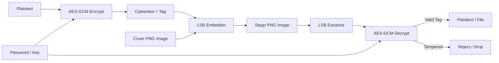

# StegoCrypt

[](https://colab.research.google.com/github/Rijzzz/StegoCrypt/blob/main/stego.ipynb)
[](./LICENSE)

A lightweight Python tool that encrypts files and text messages using AES-GCM and hides them inside the pixels of PNG images.

To anyone looking at the image, it looks like an ordinary picture. The secret is only revealed when you have the right key or password.

### How It Works



### What It Does
* Encrypts secrets with AES-256-GCM before embedding them
* Injects encrypted bits into the lowest bit (LSB) of each pixel color channel
* Leaves alpha transparency untouched so pictures never look corrupted
* Automatically rejects modified or cropped images using authentication tags
* Works with secret text messages and real files (PDFs, docs, keys)
* Includes a built-in CLI to check capacity, embed, and extract

### Capacity & Performance
Measured on Python 3.13:

| Carrier Size | Payload Capacity | Embed Speed | Extract Speed |
| :--- | :--- | :--- | :--- |
| **300 x 300 PNG** | ~32 KB | ~21 ms | ~19 ms |
| **500 x 500 PNG** | ~91 KB | ~23 ms | ~18 ms |
| **1920 x 1080 (Full HD)** | ~759 KB | ~35 ms | ~22 ms |

### Quick Start
Install dependencies:
```bash
pip install pillow cryptography
```

Run tests and benchmarks:
```bash
python stego.py
```

Check how much secret data your image can hold:
```bash
python stego.py capacity --image picture.png
```

Hide a secret message in an image:
```bash
python stego.py embed --image picture.png --out secret.png --text "Secret meeting at 5pm" --password "mypassword"
```

Extract the secret from the image:
```bash
python stego.py extract --image secret.png --password "mypassword"
```

Hide and extract a file:
```bash
python stego.py embed --image picture.png --out secret.png --file confidential.pdf --password "mypassword"
python stego.py extract --image secret.png --out recovered.pdf --password "mypassword"
```

You can also open stego.ipynb in Jupyter or Google Colab.

### My Thoughts
I built this project to combine authenticated cryptography with digital steganography. Here are a few things I learned and kept in mind while building it:
* **Why AES-GCM First:** Classic steganography just hides plain text in pixels. If someone suspects a secret, they can extract the bits easily. Encrypting first means the embedded bits look like pure random camera noise.
* **Why PNG and Not JPEG:** JPEG uses lossy compression, which averages pixel values and wipes out the lowest bit. Lossless PNG and BMP formats preserve every single bit.
* **Tamper Protection:** Because we use AES-GCM with an authentication tag, any attempt to crop, edit, or tamper with the image will cause decryption to fail safely instead of outputting corrupted garbage.
